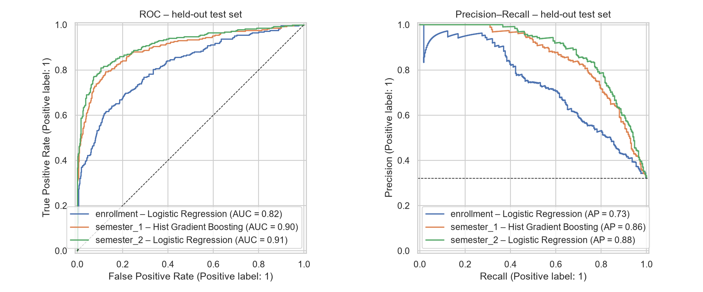
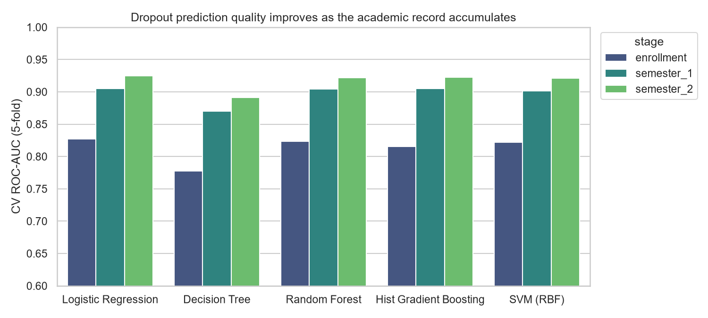
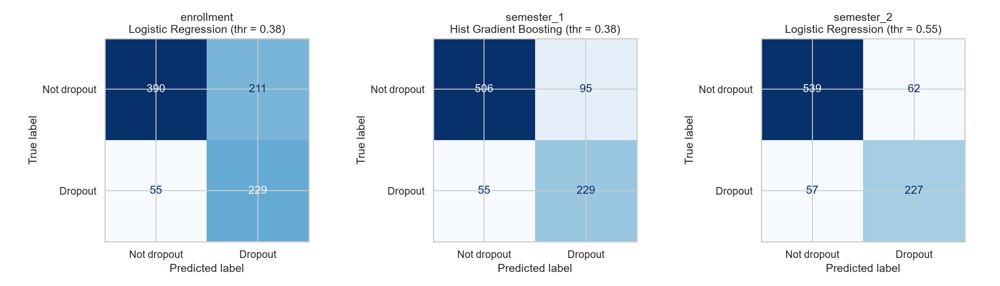
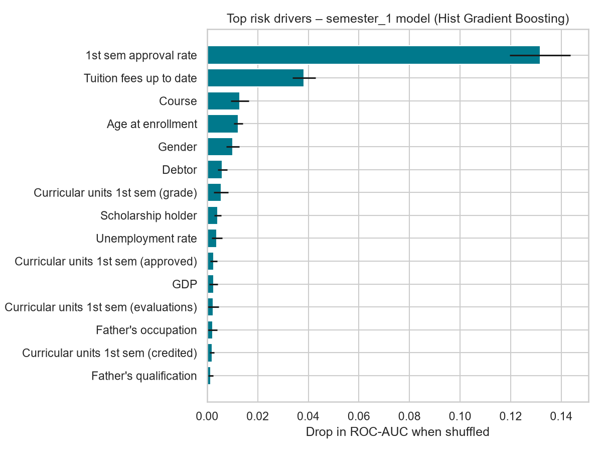
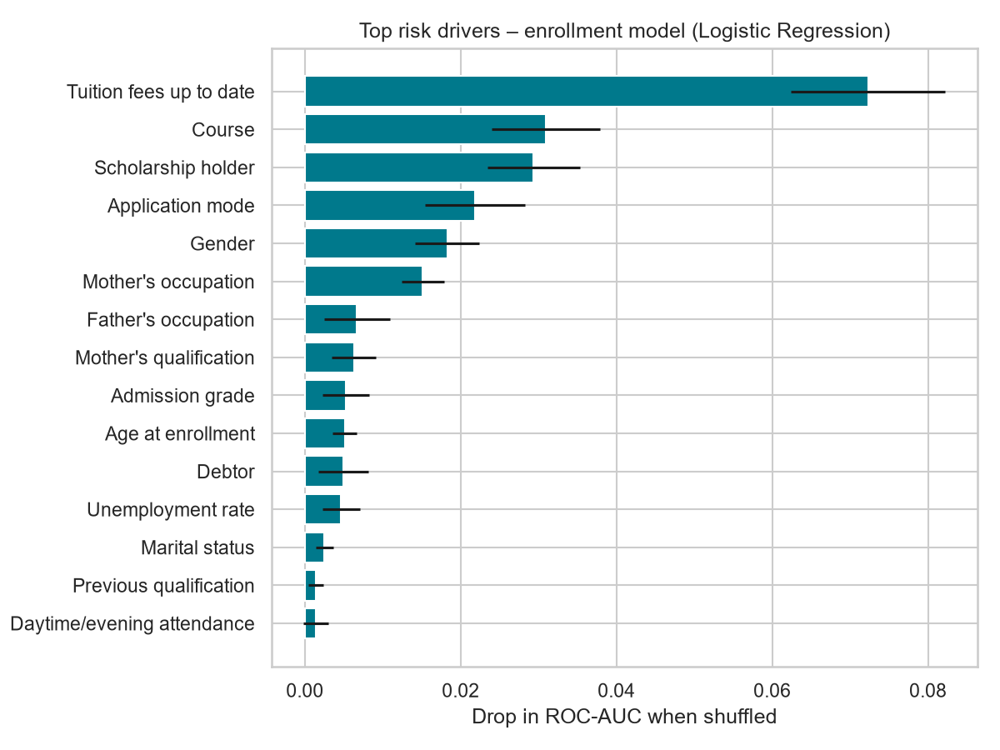
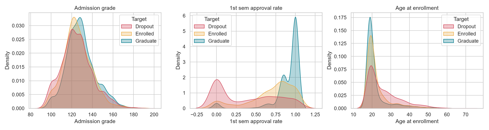
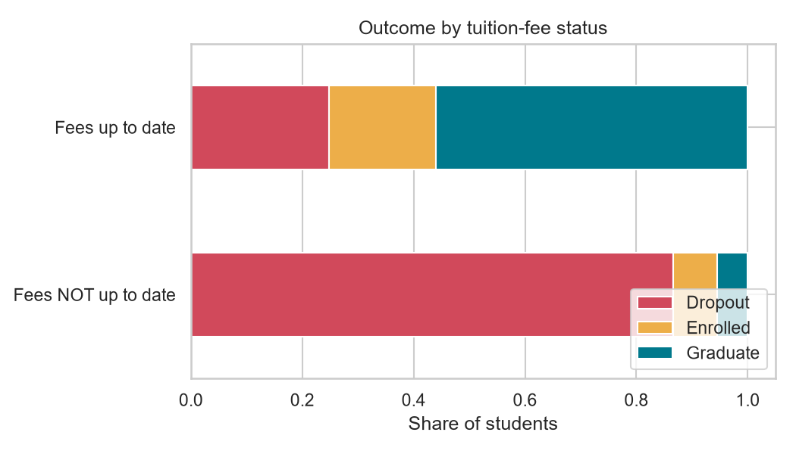

# Student Dropout Early-Warning Model

scikit-learn classifiers trained on academic records to flag students at risk of dropping out, early enough for an advisor to step in.



## Dataset

**Predict Students' Dropout and Academic Success**, from the UCI Machine Learning Repository ([id 697](https://archive.ics.uci.edu/dataset/697/predict+students+dropout+and+academic+success)).

- 4,424 undergraduate students from a Portuguese higher-education institution, enrolled 2008–2019, across 17 degree programmes
- 36 features: demographics, admission path and grade, parents' education and occupation, financial status (debtor, tuition fees, scholarship), 1st- and 2nd-semester academic performance, and macro-economic indicators
- Outcome: `Dropout` (32.1 %), `Enrolled` (17.9 %), `Graduate` (49.9 %)
- No missing values. The file is `data/students_dropout_academic_success.csv` (`;` separated), copied unmodified from UCI.

> Realinho, V., Vieira Martins, M., Machado, J., & Baptista, L. (2021). *Predict Students' Dropout and Academic Success* [Dataset]. UCI Machine Learning Repository. https://doi.org/10.24432/C5MC89 (licensed CC BY 4.0).
> Realinho, V., Machado, J., Baptista, L., & Martins, M. V. (2022). Predicting Student Dropout and Academic Success. *Data*, 7(11), 146.

## Approach

An early-warning system is only useful if it fires **before** the student leaves. So the binary task (*Dropout* vs *not Dropout*) is evaluated at three points in the student timeline:

| Stage | Information available | # features |
|---|---|---|
| `enrollment` | Day-one data: demographics, admission, family background, fees/scholarship, economy | 24 |
| `semester_1` | + 1st-semester units enrolled/evaluated/approved, grade, approval & evaluation rates | 32 |
| `semester_2` | + the same for the 2nd semester | 40 |

Pipeline (`src/dropout_ews.py`):

1. Stratified 80/20 train/test split (seed 42). The test set is used only for final reporting.
2. Preprocessing: standard-scale the numeric features and one-hot encode the 9 integer-coded nominal variables (levels with fewer than 10 students are merged as "infrequent").
3. Five classifiers, all class-weighted: Logistic Regression, Decision Tree, Random Forest, HistGradientBoosting, and an RBF SVM (calibrated).
4. Stratified 5-fold CV on the training set. The model with the best CV ROC-AUC is selected per stage.
5. **Threshold tuning:** on the out-of-fold training predictions, choose the highest threshold that still catches ≥ 80 % of dropouts. This favours recall, because missing an at-risk student costs more than an extra check-in.
6. Held-out evaluation, permutation importance, a ranked risk list, and a supplementary 3-class model.

## Results (held-out test set, n = 885, 284 dropouts)

| Stage | Selected model | ROC-AUC | PR-AUC | Recall | Precision | F1 | Students flagged |
|---|---|---|---|---|---|---|---|
| enrollment | Logistic Regression | 0.817 | 0.732 | 0.806 | 0.520 | 0.633 | 49.7 % |
| **semester_1** | **Hist Gradient Boosting** | **0.897** | **0.856** | **0.806** | **0.707** | **0.753** | **36.6 %** |
| semester_2 | Logistic Regression | 0.914 | 0.880 | 0.799 | 0.785 | 0.792 | 32.7 % |

**Takeaways**

- **The end of the 1st semester is the best time to intervene.** The semester-1 model catches 81 % of eventual dropouts with 71 % precision, close to what the full two-semester model achieves but a whole semester earlier.
- Day-one data alone still gives useful signal (AUC 0.82), but to reach 80 % recall it has to flag about half the cohort.
- Model choice matters much less than timing. Once CV noise is accounted for, Logistic Regression, Random Forest, gradient boosting and SVM are within about 0.005 AUC of each other at every stage. Only the single decision tree lags behind.
- **Risk bands are well calibrated** (semester-1 model, test set):

  | Band | Probability | Students | Actual dropout rate |
  |---|---|---|---|
  | High | ≥ 0.60 | 247 | 82.6 % |
  | Medium | 0.30–0.60 | 116 | 30.2 % |
  | Low | < 0.30 | 522 | 8.6 % |

- **Top risk drivers:**
  - Semester-1 model: 1st-semester approval rate (by far the strongest), tuition fees up to date, course, age at enrollment, gender, and debtor status.
  - Enrollment model: tuition fees up to date, course, scholarship holder, application mode, and gender.

  Financial status is the strongest signal available at enrollment.
- The 3-class model (semester-2 features, HistGradientBoosting) reaches 75.0 % accuracy and 0.70 macro-F1. *Enrolled* is the hardest class (F1 0.50), which matches the original paper.

The full tables are in [`results/results.md`](results/results.md), and the console output is in [`results/run_log.txt`](results/run_log.txt).

| | |
|---|---|
|  |  |
|  |  |
|  |  |

## Repository layout

```
data/     students_dropout_academic_success.csv      raw UCI dataset
src/      dropout_ews.py                             full training + evaluation pipeline
          predict.py                                 score new students with a saved model
models/   dropout_ews_{enrollment,semester_1,semester_2}.joblib   fitted pipelines + tuned thresholds
results/  summary.json, results.md, run_log.txt
          cv_model_comparison.csv, test_model_comparison.csv
          permutation_importance_*.csv, risk_band_summary.csv
          test_risk_scores_semester_1.csv            ranked risk list for the test cohort
          figures/*.png
```

## Reproduce

```bash
python -m venv .venv
.venv/Scripts/activate            # Windows  (Linux/macOS: source .venv/bin/activate)
pip install -r requirements.txt
python src/dropout_ews.py         # ~1–2 min; regenerates results/ and models/
python src/predict.py --stage semester_1 --input data/students_dropout_academic_success.csv --output scored.csv
```

Tested with Python 3.13 and scikit-learn 1.9.1.

## Limitations and responsible use

- The data comes from a single institution in Portugal, so the model must be re-validated before it is used anywhere else.
- Features such as gender, age, and parents' occupation are predictive, but using them to make decisions about individual students raises fairness concerns. Use the scores to **offer support**, never to penalise, and audit flag rates across groups before deploying.
- *Enrolled* students are counted as "not dropout" here, but some of them may drop out later.
